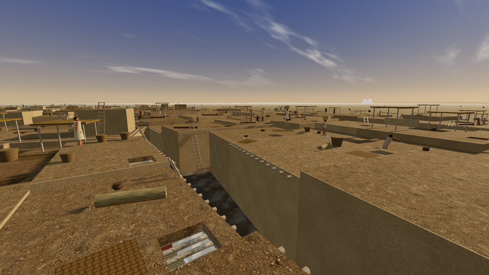

Çatalhöyük is a neolithic settlement that lasted for ~1,100 years, from 7100 to 6000 BCE. The people of Çatalhöyük appear to have no social hierarchy, little evidence of division of labor or market economy, no army or fortifications, and no official government.

They had no known public buildings, streets, or formal institutions; houses were accessible through hatches in rooftops, all connected to each other in a honeycomb fashion. Houses were similar in size and men and women ate similar diets and had similar workloads, suggesting a broadly egalitarian, gender-equal society.

They serve as a millennium-long counterexample to Hobbes's claim that social order requires a Leviathan, and potentially to what "human nature" means.

<a class="catalhoyuk-open" href="https://stephanehk.github.io/catalhoyuk/" target="_blank" rel="noopener" aria-label="Open the Çatalhöyük simulation in a new tab">
  
  Open simulation.
</a>

